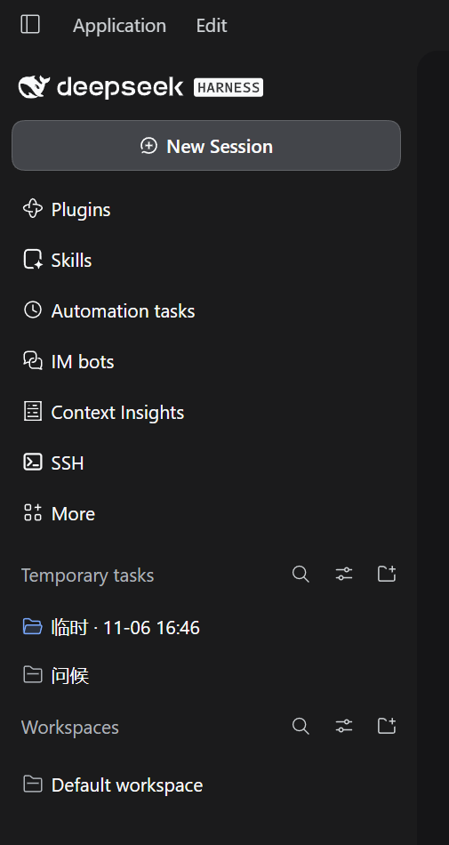
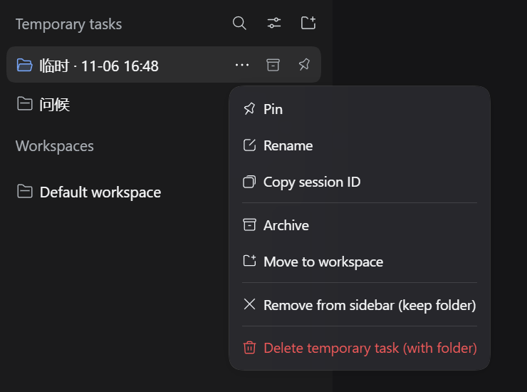
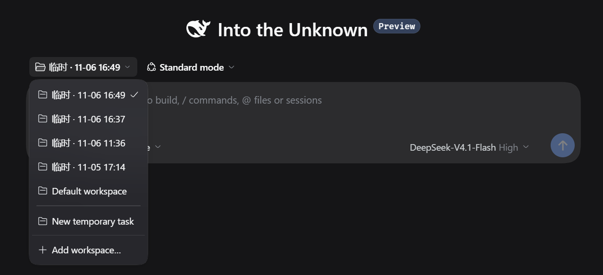
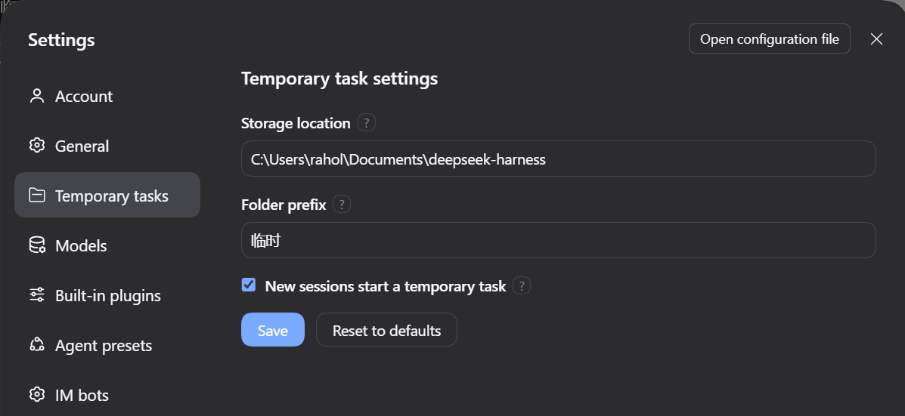

**English** | [中文](README_ZH.md)

# dsh-temp-task · Temporary tasks

> A "Temporary tasks" area above Workspaces in the DeepSeek Harness sidebar: ask a quick question, try a snippet, and get a throwaway folder and conversation in one click — without polluting your workspace list.

`DeepSeek Harness 0.2.2+` · `Windows / macOS / Linux` · `English / 中文 / 日本語 / Español / Français / Deutsch / Русский / Português` · `MIT`

## Why

DSH needs a workspace (a folder) before a conversation can start. For a quick question or a small experiment, that setup step gets in the way.

WorkBuddy's task area solves this: click New task and it creates a temporary folder, then drops you straight into the work.

dsh-temp-task adds a sibling area **above** Workspaces for exactly those throwaway tasks:

- Click **New temporary task** and the folder, workspace and session are ready; you land in the conversation.
- Tasks sit in a flat list inside the area; one click opens their own conversation and they don't take up a workspace slot.
- When you're done, right-click to delete the task alone or the task plus its folder (into the recycle bin). Switch away without sending a single message and it's reclaimed automatically.



## What a temporary task is

Each temporary task is **one real workspace + one session + one folder on disk**. Rename, archive, pin and move all reuse DSH's native capabilities, so state stays in sync with the official UI.

```
Temporary task "Explain this error"
├─ Workspace  临时 · 11-06 14:30     shown only in the plugin area
├─ Session    Explain this error     title summarized by DSH
└─ Folder     ~/Documents/deepseek-harness/临时-20261106-143000/
```

## Features

### Sidebar area

- Sits above Workspaces with its own header, `Temporary tasks`.
- Those temporary workspaces are hidden from the official list (whole groups in grouped view, their session rows in flat view), so nothing leaks into Workspaces.

### Task rows

- Same size, spacing, background and type scale as official workspace rows, with the same folder icon at the start.
- When the open conversation is this task's session, the folder switches to the blue open state, matching a selected workspace row.
- Titles show the **session title** first (DSH's session-titles summarizes after each turn); before a title exists it falls back to `临时 · MM-DD HH:mm`.
- Each row carries the same three buttons as official session rows: **⋯ menu → archive → pin**. Pinned rows show a pin at the start.

### Search, sort and filter

- Magnifier: expands a search box in place and filters by title; `Esc` or the clear button collapses it.
- Sliders: opens the same view menu as the workspace header — Order by (Manual / Last updated) and Filter sessions (Hide archived / All conversations / Archived only).
- The sort preference is stored in `localStorage`.

### Context menu

Ordered like the official session menu:



| Item | Behavior |
| --- | --- |
| Pin / Unpin | Uses the official session pin; pinned tasks move to the top of the area |
| Rename | Inline edit of the session title; once set, auto-summarizing stops overwriting it |
| Copy session ID | Copies the session ID to the clipboard |
| Archive / Unarchive | Uses the official session archive; archived tasks are hidden by the filter by default |
| Move to workspace | Promotes the task in place: the folder stays put; the temporary workspace is unregistered and the same path is registered as a regular workspace |
| Remove from sidebar (keep folder) | Archives the session, unregisters the workspace and deletes the record; folder and files stay |
| Delete temporary task (with folder) | Archives the session, moves the folder to the recycle bin, then unregisters the workspace |

### New sessions start as temporary tasks

A switch in the plugin settings controls this behavior.

On by default: clicking **New session** at the top creates and opens a temporary task immediately — no workspace picker. The workspace dropdown on the new-session page also gains a **New temporary task** row.



Turn the switch off and both the top button and the dropdown return to DSH's native behavior.

### Empty tasks are reclaimed

Create a task and switch to another session without sending a message and the task is deleted immediately: workspace unregistered, record removed, empty folder deleted (if the folder already holds other files it goes to the recycle bin instead). This matches DSH's own "blank session disappears when you switch away" behavior.

Tasks that have sent messages are never reclaimed.

### Long titles scroll

When a title is clipped, hovering the row scrolls it to reveal the rest, just like workspace sessions; moving away snaps back to the start. It scrolls only when more than 8px is hidden, and jumps straight to the end when the system's reduced-motion setting is on.

### Settings

**Settings → Temporary tasks** (or **Settings → Plugins → dsh-temp-task**) lets you change:

- **Storage location** — parent folder for new task folders; defaults to `~/Documents/deepseek-harness`.
- **Folder prefix** — default `临时`; used in folder names and fallback titles.
- **New sessions start a temporary task** — on by default; see above.



Every setting has a "?" that shows its help on hover. **Changes apply to newly created tasks only**: existing folders don't move or get renamed, and can still be opened, archived and deleted as before.

### Languages

Follows DSH's language setting; all 8 built-in languages are translated in full, error messages included: `zh`, `en`, `ja`, `es`, `fr`, `de`, `ru`, `pt`. Switching languages updates the sidebar, menus, settings page and tooltips live — no restart.

All UI strings live in `locale/<lang>.json` and load for the active language.

## Install

Requires DeepSeek Harness 0.2.2+ and Node.js 22+.

1. Put this folder anywhere local (`git clone` works).
2. Install it as a local bundle in DSH, passing the **absolute path** of this folder as `target`:
   ```
   plugin_manager install_bundle  target = <absolute path to this folder>
   ```
   Or use Settings → Plugins → install a local bundle.
3. Refresh the window (`Ctrl+R`). If the update includes host-side code (`index.js` / `service.js` / `store.js`), fully quit and restart DSH.

Local folders are linked, not copied: after editing client JS, just refresh. Don't hand-edit the profile's `package.json` / `cordis.patch.yml`, and don't run pnpm inside the profile folder.

## Usage

| I want to… | How |
| --- | --- |
| Create a task | Click ⊕ next to the area header, or New session at the top (with the switch on) |
| Open its conversation | Left-click the row |
| Read a clipped title | Hover the row; the title scrolls and snaps back on leave |
| Rename | Hover ⋯ → Rename, or right-click → Rename |
| Pin | Hover the pin button, or right-click → Pin |
| Archive | Hover the archive button, or right-click → Archive; control visibility from the view menu afterwards |
| Search | Click the magnifier in the header |
| Move to a workspace | Right-click → Move to workspace |
| Delete | Right-click → Delete temporary task (with folder) |

## Configuration

Values saved from the settings page live in `<DSH_HOME>/dsh-temp-task/<profile-hash>/settings.json`; the task list is `tasks.json` in the same folder.

When upgrading from an older version, data under `<DSH_HOME>/temp-task-zone/<profile-hash>/` migrates automatically at DSH startup. If both folders exist, only missing files are copied — existing data is never overwritten.

`apply(ctx, config)` also accepts two optional fields, used as defaults when no settings have been saved:

| Field | Default | Description |
| --- | --- | --- |
| `rootDirectory` | `~/Documents/deepseek-harness` | Parent folder for temporary folders; supports `~/`; must be absolute |
| `dirPrefix` | `临时` | Folder-name prefix and fallback-title prefix |

Precedence: **saved settings > `apply` config > built-in defaults**.

Path rules: the storage location must be absolute (the error example is platform-specific); the prefix can't be empty or `.` / `..`, can't contain path separators or control characters (Windows additionally forbids `: * ? " < > |`), and is limited to 40 characters. "Reset to defaults" only fills the form with defaults — you still need to save.

## Data and safety

- Folder names look like `临时-YYYYMMDD-HHmmss`; a collision within the same second appends `-2`, `-3`. Each folder contains an ownership marker, `.dsh-temp-task-owner.json`.
- Deletion is validated item by item: the folder must be under a known root, the marker's id must match the record, and the session must not be running. Any mismatch refuses the delete.
- Deletes always go to the system recycle bin: on Windows through `Microsoft.VisualBasic.FileIO`'s `SendToRecycleBin`, on macOS to `~/.Trash` (with a Finder fallback across volumes), on Linux through `gio trash`. **If the recycle bin is unavailable the whole operation fails — it never degrades to permanent deletion.**
- Changing the storage location doesn't affect old tasks: every record keeps the folder and root from creation time, so old tasks still open, delete and archive normally.
- Every task is still a real workspace, so it also shows up in DSH's native dropdowns such as Recent workspaces and Choose workspace. The plugin can only control what the sidebar displays.

## Known limitations

- The sidebar area, task rows and new-session entry point are **DOM-level integrations** that depend on the official sidebar structure. If an upstream change removes the anchors, the plugin **stops silently** and the native UI takes over — nothing else breaks.
- The view menu uses the official `primitives.Menu`. If the runtime can't provide `react` / `react-dom/client`, that button disappears; search, folding, ⊕ and the other pure-DOM features keep working.
- Linux without a desktop environment may lack `gio`; deletes then report an error and ask you to move the folder to the recycle bin manually. On macOS the Finder fallback may ask for Automation permission once. Neither platform ever deletes by mistake.
- In grouped view the temporary area is capped at `42vh` and scrolls internally when you have many tasks.

## Development

```
index.js       Host entry: config, RPC channel, startup logging
service.js     Task service: create/open/delete/move/reclaim/reconcile
store.js       State and folders: naming, ownership marker, settings.json, tasks.json
errors.js      Stable error codes (thrown by the host, translated on the client)
trash.js       Cross-platform recycle bin
client.js      Client: sidebar injection, task rows, menus, search, settings page
locale/*.json  8 languages
tests/         node:test suites (38 tests)
```

```bash
node --test tests/store.test.js tests/index.test.js
```

Client changes apply on window refresh (`Ctrl+R`); host-side changes (`index.js`, `service.js`, `store.js`, `trash.js`) need a full DSH restart.

## Uninstall

Remove this bundle in plugin management and restart. Existing temporary folders are not deleted; to clean up, right-click → Delete temporary task (with folder) one by one, or move the folders to the recycle bin yourself.

## License

MIT — see [LICENSE](LICENSE).
