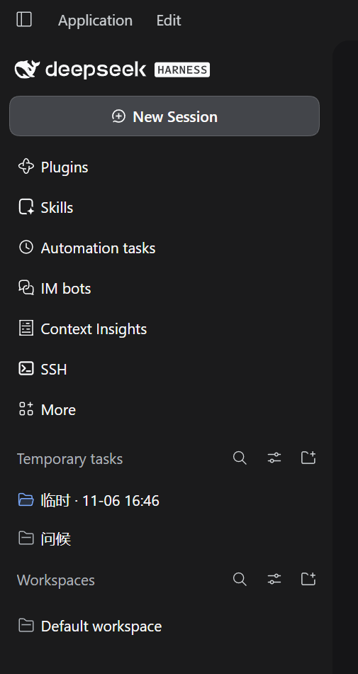
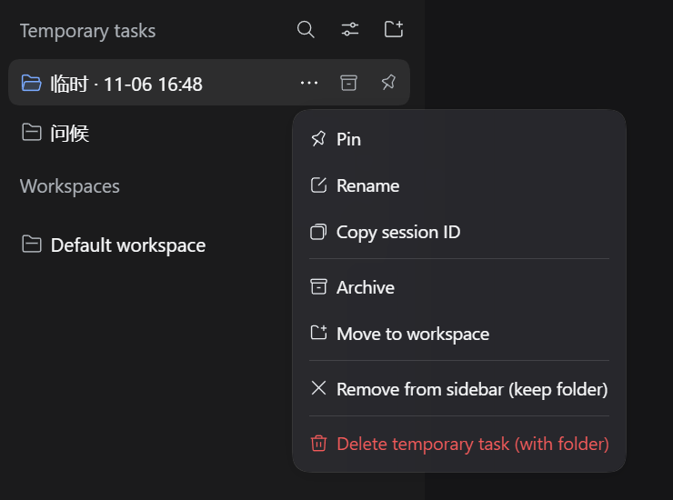
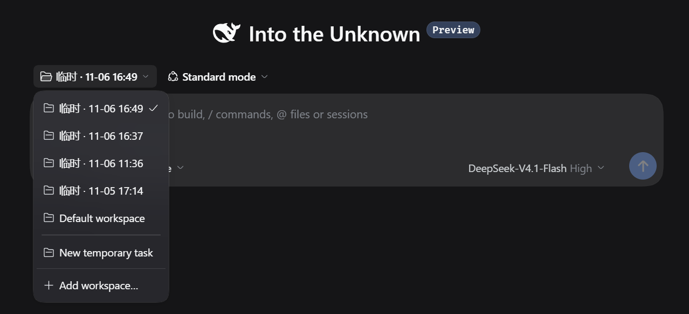
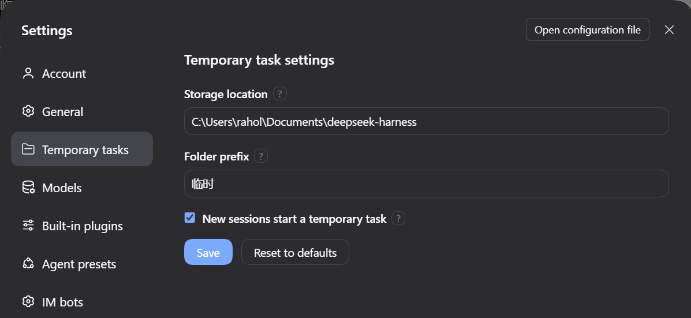

[English](README.md) | **中文**

# dsh-temp-task · 临时任务区

> 给 DeepSeek Harness 的左侧栏加一块「临时任务」区域：随手问一句、试一段代码，点一下就有独立目录和对话，不再弄脏你的工作区列表。

`DeepSeek Harness 0.2.2+` · `Windows / macOS / Linux` · `中文 / English / 日本語 / Español / Français / Deutsch / Русский / Português` · `MIT`

## 为什么需要它
DSH 默认需要一个工作区（文件夹）才能展开对话，对于临时问一句、跑个实验等零散工作，这个准备步骤就会显得比较麻烦。

因此参考了 WorkBuddy 的实现：WorkBuddy 有个任务区，点击新建任务，可以直接帮你创建一个临时目录，并快速开展一个任务。

类似的，dsh-temp-task 在工作区**上方**加了一个同级区域，专门收留这些用完即走的任务：

- 点「新建临时任务」就建好目录、工作区、会话，并直接进入对话；
- 任务在区域里扁平排列，点一下直达它自己的对话，不占工作区名额；
- 不需要了，右键删掉，可以只删除任务，也可以连带目录一起删掉进回收站；一条消息都没发就切走的，还会自动回收。



## 一个临时任务是什么

每个临时任务 = **一个真实工作区 + 一条会话 + 一个磁盘目录**。所以重命名、归档、置顶、移动全都复用 DSH 官方能力，状态与官方界面天然同步。

```
临时任务「查一下这个报错」
├─ 工作区  临时 · 11-06 14:30     只在插件区域里显示
├─ 会话    查一下这个报错          由 DSH 自动总结标题
└─ 目录    ~/Documents/deepseek-harness/临时-20261106-143000/
```

## 功能

### 侧栏区域

- 位于「工作区」之上，独立标题栏：`临时任务`。
- 这些临时工作区在官方列表里被整块隐藏（分组视图隐藏分组，扁平视图隐藏会话行），「工作区」里看不到。

### 任务行

- 样式：尺寸、间距、底色、字号都照抄官方工作区行，行首是官方同款文件夹图标。
- 当前打开的正是这个任务的会话时，文件夹变成蓝色的打开状态，和官方工作区行的选中态一致。
- 标题优先显示**会话标题**（DSH 的 session-titles 会在每轮对话后自动总结）；会话还没有标题时，回退成「临时 · MM-DD HH:mm」。
- 任务上同样带三个官方会话行同款按钮：**⋯ 菜单 → 归档 → 置顶**，置顶后行首显示图钉。

### 查找、排序与筛选

- 放大镜：就地展开搜索框，按标题过滤，`Esc` 或清除按钮收起。
- 滑杆：打开与工作区标题栏同款的视图菜单——排序方式（手动 / 最近更新）、筛选会话（隐藏已归档 / 全部对话 / 仅显示已归档）。
- 排序偏好存在 `localStorage`。

### 右键菜单

顺序与官方会话菜单对齐：



| 菜单项 | 行为 |
| --- | --- |
| 置顶 / 取消置顶 | 调官方会话置顶，置顶任务排到区域最前 |
| 重命名 | 行内编辑，改的是会话标题；手动改过后自动总结不再覆盖 |
| 复制会话 ID | 写入剪贴板 |
| 归档 / 取消归档 | 调官方会话归档；归档后默认由筛选隐藏 |
| 移动到工作区 | 原地「转正」：目录不挪动，注销临时工作区后把同一路径登记成普通工作区 |
| 仅从侧栏移除（保留目录） | 归档会话、注销工作区、删除记录，磁盘目录与文件保留 |
| 删除临时任务（含目录） | 归档会话，目录移入系统回收站，再注销工作区 |

### 新会话直接进入临时任务
插件设置里有个开关：新会话默认进临时任务。

默认开启：开启后，点顶部「新会话」会**直接创建并进入一条临时任务**，不用再选工作区；新会话页的工作区下拉里也会多出「新建临时任务」一行。



在设置里关掉后，顶部按钮和下拉都恢复 DSH 原生行为。

### 自动回收空任务

新建后**一条消息都没发**就切到别的会话，这个任务会立即删除：注销工作区、删除记录、删除空目录（目录里已有其他文件则改走回收站）。行为与官方「空白会话切走直接消失」保持一致。

已经发过消息的任务，都不会被回收。

### 标题太长时自动滚动

任务标题被截断时，鼠标移到这一行上，标题会像工作区会话一样自动向右滚动，把后半段露出来；移开立即回到开头。溢出不足 8px 不滚动；系统开启「减少动态效果」时直接跳到末尾。

### 设置

**设置 → 临时任务**（或 **设置 → 插件 → dsh-temp-task**）可以改：

- **存放位置**：新任务目录的父目录，默认 `~/Documents/deepseek-harness`；
- **目录前缀**：默认 `临时`，决定目录名与回退标题；
- **新会话默认进临时任务**：默认打开。行为已在前置章节说明。



每个设置项右侧有「?」，鼠标移上去立即显示说明。**改动只影响之后新建的任务**，已有任务的目录不搬家、不重命名，打开 / 归档 / 删除照常。

### 多语言

跟随 DSH 的语言设置自动切换，内置 8 种语言全量翻译（含错误提示）：`zh`、`en`、`ja`、`es`、`fr`、`de`、`ru`、`pt`。切换语言后侧栏、菜单、设置页、气泡提示都会实时更新，不需要重开。

界面文字全部放在 `locale/<语言>.json`，按当前语言加载。

## 安装

要求：DeepSeek Harness 0.2.2 及以上，Node.js 22+。

1. 把本目录放到本地任意位置（可 `git clone`）；
2. 在 DSH 里安装本地 bundle，`target` 传本目录的**绝对路径**：
   ```
   plugin_manager install_bundle  target = <本目录绝对路径>
   ```
   或在 设置 → 插件 里选择安装本地 bundle。
3. 刷新窗口（`Ctrl+R`）。如果这次更新包含宿主侧代码（`index.js` / `service.js` / `store.js`），需要完全退出并重开 DSH。

本地目录是链接安装，改完客户端 JS 刷新窗口即可；不要手改 profile 的 `package.json` / `cordis.patch.yml`，也不要在 profile 目录里跑 pnpm。

## 使用

| 想做什么 | 怎么做 |
| --- | --- |
| 新建任务 | 点区域标题右侧的 ⊕；或点顶部「新会话」（开关打开时） |
| 打开对话 | 左键任务行 |
| 看完整标题 | 鼠标移到任务行，标题自动滚动；移开回到开头 |
| 重命名 | hover 行尾 ⋯ → 重命名，或右键 → 重命名 |
| 置顶 | hover 行尾图钉按钮，或右键 → 置顶 |
| 归档 | hover 行尾归档按钮，或右键 → 归档；之后用视图菜单控制是否显示 |
| 搜索 | 点标题栏放大镜 |
| 移到工作区 | 右键 → 移动到工作区 |
| 删除 | 右键 → 删除临时任务（含目录） |

## 配置

设置页保存的值写在 `<DSH_HOME>/dsh-temp-task/<profile-hash>/settings.json`；任务清单在同目录的 `tasks.json`。

从旧版本升级时，`<DSH_HOME>/temp-task-zone/<profile-hash>/` 里的数据会在 DSH 启动时自动迁移到新目录；两个目录都存在时只补齐新目录缺少的文件，不会覆盖已有数据。

`apply(ctx, config)` 还接受两个可选字段，作为**没有保存过设置**时的默认值：

| 字段 | 默认 | 说明 |
| --- | --- | --- |
| `rootDirectory` | `~/Documents/deepseek-harness` | 临时目录的父目录，支持 `~/`，必须是绝对路径 |
| `dirPrefix` | `临时` | 目录名前缀与回退标题前缀 |

优先级：**设置页保存值 > `apply` 配置 > 内置默认**。

路径规则：存放位置必须是绝对路径（错误示例按当前平台显示）；前缀不能为空、不能是 `.` / `..`、不能含路径分隔符与控制字符（Windows 还禁止 `: * ? " < > |`）、最多 40 字符。「恢复默认」只把表单填回默认值，仍需点保存。

## 数据与安全

- 目录名格式 `临时-YYYYMMDD-HHmmss`，同一秒重名自动加 `-2`、`-3`；目录内写有归属标记 `.dsh-temp-task-owner.json`。
- 删除前逐项校验：目录在已知根目录之下、归属标记的 id 与记录一致、会话不在运行。任一不满足就拒绝。
- 删除一律进系统回收站：Windows 走 `Microsoft.VisualBasic.FileIO` 的 `SendToRecycleBin`，macOS 先进 `~/.Trash`（跨卷时改用 Finder），Linux 走 `gio trash`。**回收站不可用时整体失败，绝不降级为永久删除。**
- 改存放位置不影响旧任务：每条记录都保存了建任务时的目录与根，旧任务仍可正常打开、删除、归档。
- 每个任务仍是真实工作区，所以也会出现在 DSH 的「最近工作区」「选择工作区」等原生下拉里，插件只能控制侧栏内的展示。

## 已知限制

- 侧栏区域、任务行、新会话入口都是 **DOM 级集成**，依赖官方侧栏结构。上游改版导致锚点找不到时，插件会**静默停用**、回到原生界面，不会破坏已有功能。
- 视图菜单用的是官方 `primitives.Menu`，如果运行环境取不到 `react` / `react-dom/client`，这个按钮会自动消失，搜索、折叠、⊕ 等纯 DOM 功能不受影响。
- 无桌面环境的 Linux 可能没有 `gio`，此时删除会报错并提示手动移入回收站；macOS 的 Finder 兜底首次使用可能弹一次「自动化」授权。这两个平台都不会误删。
- 分组视图下临时区域最高 `42vh`，任务很多时区域内部滚动。

## 开发

```
index.js       宿主入口：配置、RPC 通道、启动日志
service.js     任务服务：创建/打开/删除/移动/回收/对账
store.js       状态与目录：命名、归属标记、settings.json、tasks.json
errors.js      稳定错误码（宿主抛出、客户端按语言翻译）
trash.js       跨平台回收站
client.js      客户端：侧栏注入、任务行、菜单、搜索、设置页
locale/*.json  8 种语言文案
tests/         node:test 用例（38 条）
```

```bash
node --test tests/store.test.js tests/index.test.js
```

客户端改动刷新窗口（`Ctrl+R`）生效；宿主侧（`index.js`、`service.js`、`store.js`、`trash.js`）改动需要完全重启 DSH。

## 卸载

在插件管理里移除本 bundle 并重启。已存在的临时目录不会被删除；需要清理时，先逐个用右键「删除临时任务（含目录）」，或手动把目录移入回收站。

## License

MIT，见 [LICENSE](LICENSE)。
